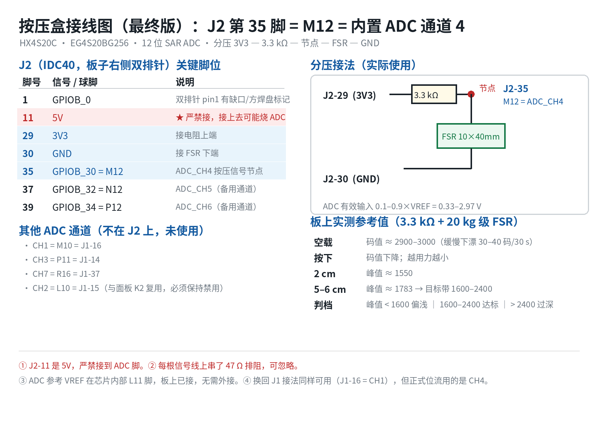

# 作品定稿 · 定位 / 效果 / 名称 / 简介

> 本文档整合前面所有讨论，作为**唯一权威版本**
> 场景：无障碍信息终端 | 平台：安路 HX4S20C（EG4S20BG256） | 赛道：安路
> 定稿日期：2026-09-14

---

## 一、一句话定位

> **一块屏，服务从"分不清颜色"到"完全看不见"的整个谱系。**
>
> 在医院门诊大厅，普通人看到的是一块正常的窗口指引屏；
> 按一下键，它就为视障及老年患者变成"大字 + 语音"的无障碍终端。
> 全部逻辑在一颗 FPGA 内运行，没有操作系统，不怕死机，插电就用。

---

## 二、需求依据

### 2.1 法律依据

**《中华人民共和国无障碍环境建设法》**（2023 年 9 月 1 日施行）**第三十三条**：

> 音视频以及多媒体设备……应当逐步具备**语音、大字等无障碍功能**。
> **银行、医院、城市轨道交通车站、民用运输机场航站区、客运站、客运码头、大型景区等的自助公共服务终端设备，应当具备语音、大字、盲文等无障碍功能。**

同法第二十九条、第四十条、第四十七条分别对信息发布、公共服务机构、应急避难场所提出了"语音、大字"要求。

**本作品即对该法条的技术实现样本。**

### 2.2 数据依据

| 群体 | 规模 | 视力状况 | 需要的通道 |
|---|---|---|---|
| **色觉异常者** | **超 3000 万**（第七次人口普查） | 有视力，辨色困难 | 色彩冗余编码 |
| **视障人士** | **超 1700 万**（中国残联，2023） | 含低视力与全盲 | 大字 + 语音 |
| **60 岁以上老年人** | **3.1 亿**（国家统计局，2024 年末） | 有视力，但衰退 | 大字 + 高对比 + 语音 |
| 其中受白内障/老花困扰 | **超 2 亿** | | |

**合计受众超过 2 亿人**，且全部为"看得见（或曾经看得见）"的群体——**正是多媒体融合真正发挥作用的场景**。

### 2.3 现实痛点

**问题一：公共信息以纯视觉方式呈现，对视障人群完全失效**

医院、银行等场所现有的窗口指引屏、叫号屏，**全部依靠视觉呈现信息**。视障人士与视力衰退的老年人无法从中获取"去哪个窗口、办什么业务"，只能反复询问工作人员——在人多嘈杂的门诊大厅，这件事尤其困难。

**问题二：单纯依赖语音外放会扰民**

青年报 2024 年 12 月的实地报道指出：为公交站加装车外语音播报是有效的解决思路，但**因外放扰民遭居民投诉，多地取消**。

**这说明：无障碍语音必须与"公共广播"区分开。**

**本作品的应对**

| 设计 | 解决什么 |
|---|---|
| **视觉通道保留** | 不牺牲普通人的使用体验，一块屏服务所有人 |
| **语音近场输出** | 面向屏幕前的使用者，而非覆盖整个大厅 |
| **一键切换模式** | 只在需要时启动语音，不持续打扰环境 |
| **语音与画面同步** | 使用者可自行对照，也可只听不看 |

来源：[青年报 · 视障人士如何"听见"公交？](http://www.why.com.cn/epublish/qnb/html/2024-12/03/content_121_28462.htm)

---

## 三、受众谱系（回应"盲人看不到画面"的质疑）

| 受众 | 视觉通道 | 听觉通道 | 融合价值 |
|---|---|---|---|
| **色觉异常** | 色彩冗余编码（形状/文字辅助） | 辅助 | ✅ 双通道互补 |
| **低视力** | 大字 + 高对比 | 强化 | ✅ **双通道互相增强** |
| **老年人** | 大字 + 高对比 | 强化 | ✅ **双通道互相增强** |
| 全盲 | — | 独立可用 | 边界兜底覆盖 |

**核心论点**：

> "融合"的价值在于**同一份信息、多条通路冗余**，而不在于"每个人都必须同时用两条通路"。
> **多通道冗余本身就是无障碍设计的核心原则。**

**演示重心**放在前三行（能看见的群体）——此时音画融合是实打实的。全盲是设计覆盖的边界，不作为演示主打。

---

## 四、作品名称（≤15 字）

| 候选 | 字数 | 特点 |
|---|---|---|
| **`视听协同无障碍终端`** | 9 | ⭐ 突出"视听协同"，正面回应融合质疑 |
| **`音视频融合无障碍终端`** | 10 | 呼应赛题"音视频融合"的原词 |
| `无障碍信息播报终端` | 9 | 简洁，但未体现融合 |
| `多通道无障碍信息终端` | 10 | 突出冗余，略学术 |

### 推荐

```
视听协同无障碍终端
```

**9 字。** 理由：

1. **"视听协同"把"融合"摆在名称里** —— 直接回应"盲人看不到画面、体现不出融合"的质疑
2. **不设限于任何单一群体** —— "无障碍"是法律用语，涵盖全谱系
3. **短** —— 留有余量

> 备选：若想更贴赛题原词，用 `音视频融合无障碍终端`（10 字）。

---

## 五、作品简介（≤500 字）

### 版本 A：标准版（约 490 字，推荐）

```
本作品面向医院等公共场所视力受限人群的信息获取需求，覆盖从"辨色困难"到
"完全看不见"的完整谱系。现有信息屏以纯视觉方式呈现内容，对色觉异常者、
低视力人群及视力衰退的老年人均存在阅读障碍。我国有超 3000 万色觉异常者、
1700 余万视障人士、3.1 亿 60 岁以上老年人。

本作品基于安路 EG4S20 FPGA 构建"视觉 + 听觉"双通道信息播报终端：视觉通道
以 FPGA 实时渲染的超大字号、高对比度与色觉友好编码呈现信息；听觉通道同步
播报语音。两条通道构成信息冗余，任一路径均可独立获取完整信息。《无障碍环境
建设法》第三十三条要求医院、银行等场所的自助公共服务终端应具备语音、大字等
无障碍功能，本作品即该要求的技术实现。

应用于医院候诊区与缴费窗口时，患者可按键切换窗口信息页，查看业务名称与服务
时间；视障及老年患者可一键进入无障碍模式，以大字与语音同步获取信息。

系统分为媒体读取、帧缓存、渲染、HDMI 输出与交互控制五层，在 FPGA 内完成
点阵字模渲染、字形缩放与图层叠加；并设计分级复位与异常自恢复机制，保障
长期无人值守运行的可靠性。
```

> ✅ **实测 460 字**（去空白计），在 500 字限制内。
> 若表单计数器算得偏大导致超限，可删掉"系统分为……五层"那一段，降到约 375 字。
> **本简介不含团队身份信息**（作品简介用于作品本身，与队伍资质无关）。

### 版本 B：精简版（约 300 字，表单紧张时用）

```
本作品面向医院等公共场所视力受限人群的信息获取需求，覆盖从"辨色困难"到
"完全看不见"的完整谱系。现有信息屏以纯视觉方式呈现内容，对色觉异常者、
低视力人群及视力衰退的老年人均存在阅读障碍。我国有超 3000 万色觉异常者、
1700 余万视障人士、3.1 亿 60 岁以上老年人。

本作品基于安路 EG4S20 FPGA 构建"视觉 + 听觉"双通道信息播报终端：视觉通道
以 FPGA 实时渲染的超大字号、高对比度与色觉友好编码呈现信息；听觉通道同步
播报语音。两条通道构成信息冗余，任一路径均可独立获取完整信息。《无障碍环境
建设法》第三十三条要求医院、银行等场所的自助公共服务终端应具备语音、大字等
无障碍功能，本作品即该要求的技术实现。
```

---

## 六、成品效果与功能

### 6.1 硬件形态

```
      ┌──────────────────┐
      │   HDMI 显示器     │◄────────── HDMI 线 ──────┐
      │   （带喇叭）      │                          │
      └──────────────────┘                          │
                                        ┌───────────┴─────────┐
                                        │  HX4S20C 开发板      │
                                        │  ┌─────────┐         │
                                        │  │ EG4S20  │ TF 卡槽 │
                                        │  └─────────┘   ▲     │
                                        │  [按键][按键]  │     │
                                        └────────────────┼─────┘
                                              USB 供电   │
                                                      TF 卡
                                          （图片 + 字库 + 语音）
```

**不需要电脑、不需要网络、不需要操作系统。**

按压盒与开发板只用一根三线电缆相连（J2 排针），走的是板载 12 位 ADC：



分压比由 3.3 kΩ 与 FSR 的电阻共同决定：空载节点约 3.0 V（码值 2900~3000），按下后 FSR 阻值下降、节点电压下降、码值随之变小；峰值码值的变化量就是这一下的按压强度。**J2 第 11 脚是 5 V，严禁接到 ADC 脚。**

### 6.2 开机表现

| 时间 | 现象 |
|---|---|
| 0.0s | 板载配置指示灯亮 |
| 约 1~2s | **显示器出现画面，直接开始播放** |

**没有开机画面、没有加载条、没有"正在启动"。**

### 6.3 普通模式

**场景：医院门诊大厅的窗口指引屏。** 屏幕显示图文信息页，**文字由 FPGA 实时渲染**（非预制图片）：

```
┌────────────────────────────────────────┐
│  ✚  门诊大厅 · 窗口指引        1 / 5   │
├────────────────────────────────────────┤
│                                        │
│         ３ 号 窗 口                     │
│                                        │
│         办 理 社 保 卡                  │
│                                        │
│         服务时间  9:00 - 17:00          │
│                                        │
├────────────────────────────────────────┤
│        ●  ○  ○  ○  ○                   │
└────────────────────────────────────────┘
```

- 每 5 秒自动翻页（**周期可配置**）
- 翻页采用**淡出淡入**过渡
- 供候诊患者查看各窗口的业务与时间

### 6.4 无障碍模式（按一个键）

**三项变化同时发生**：

| 变化 | 作用 |
|---|---|
| 背景简化为纯色 | 去除视觉干扰 |
| 字号放大 3~4 倍 | 低视力可辨认 |
| 对比度提升至最高 | 配合色觉友好配色 |
| **语音同步播报** | 听觉通道 |

```
┌────────────────────────────────────────┐
│████████████████████████████████████████│
│████████████████████████████████████████│
│██                                    ██│
│██      ３ 号 窗 口                    ██│
│██                                    ██│
│██      办 理 社 保 卡                 ██│
│██                                    ██│
│████████████████████████████████████████│
│████████████████████████████████████████│
└────────────────────────────────────────┘
   🔊 "3 号窗口，办理社保卡。服务时间，9 点到 17 点。"
```

**视障及老年患者只需按一个键，就能获得可看见的大字与可听见的语音。**

### 6.5 交互操作

| 按键 | 功能 |
|---|---|
| 上一页 / 下一页 | 切换信息页 |
| 模式切换 | 普通 ↔ 无障碍 |
| 重播 | 语音重播当前页 |

### 6.6 演示脚本

**演示场景：医院门诊大厅窗口指引屏**

| 步骤 | 操作 | 现象 |
|---|---|---|
| ① | 插电 | 显示器 2 秒内亮起，显示「1 号窗口 · 挂号收费」，开始自动轮播 |
| ② | 按下一页 | 切到「2 号窗口 · 医保结算」，淡出淡入 |
| ③ | 按「无障碍」键 | 屏幕变为大字高对比，**语音同步播报"2 号窗口，医保结算"** |
| ④ | 按下一页 | 切到「3 号窗口 · 办理社保卡」，大字页面切换 + 语音同步换内容 |
| ⑤ | 按「重播」 | 语音重新播报当前页 |
| ⑥ | 切回普通模式 | 恢复常规显示 |
| ⑦ | 静置观察 | 连续运行不花屏、不卡死 |

**第 ③ 步是全场的高光时刻**——评委亲眼看到"一块普通的指引屏，为一个看不见的人改变了形态"。**这件事不需要解释，看一眼就懂。**

---

## 七、技术方案（9 个技术点）

| # | 技术点 | 解决什么问题 | 难度 |
|---|---|---|---|
| 1 | **点阵字模渲染引擎** | 640×480 下显示超大汉字（非预制图片） | ⭐⭐⭐⭐ |
| 2 | 字形硬件缩放 | 不同视力程度需不同字号 | ⭐⭐⭐ |
| 3 | 图层叠加 + 底衬 | 文字在复杂背景上仍可读 | ⭐⭐⭐ |
| 4 | 色彩查表（LUT） | 高对比模式、亮度调节 | ⭐⭐ |
| 5 | **色觉友好编码** | 不只靠颜色传信息（服务色觉异常者） | ⭐⭐ |
| 6 | 音画同步播报 | 全盲/低视力用户获取信息 | ⭐⭐⭐ |
| 7 | 双模式切换 | 两种人群共用一块屏 | ⭐⭐ |
| 8 | 可靠性设计 | 公共设施无人值守 | ⭐⭐⭐ |
| 9 | 淡入淡出转场 | 避免画面突变不适 | ⭐⭐ |

### 系统架构

```
  TF 卡（BMP 图片 / GB2312 点阵字库 / PCM 语音）
        │ SPI
  ┌─────▼────────────────────────────────────┐
  │ ① 媒体读取层  FAT32 解析 + 文件描述符表    │
  ├─────▼────────────────────────────────────┤
  │ ② 帧缓存层    片内 SDRAM 8MB 整帧缓存      │
  ├─────▼────────────────────────────────────┤
  │ ③ 渲染处理层  ★核心                       │
  │    字模读取 → 字形缩放 → 图层混合 → LUT    │
  ├─────▼────────────────────────────────────┤
  │ ④ HDMI 输出层  视频时序 + 音频数据岛+TMDS  │
  └─────┬────────────────────────────────────┘
        │
     HDMI ──► 显示器 / 音箱

  按键 ──► ⑤ 交互控制层（切页 / 模式 / 重播）
```

### ⚠️ 必须避开的红线

赛题原文禁止"算法预处理"：

> 不得带有额外处理器（无论用于辅助控制还是**算法预处理**）

**因此绝不能用 PC 把文字渲染成 BMP 图片。** 必须由 FPGA 读取点阵字库并实时渲染——**这恰恰是本作品的技术含量所在**。

---

## 八、与赛题要求的对应

### 基础要求（全部覆盖）

| 要求 | 实现 |
|---|---|
| 本地媒体资源读取 | TF 卡 + FAT32 + BMP 解码 |
| 稳定图像缓存与 HDMI 显示 | SDRAM 帧缓存 + TMDS 输出 |
| 多图片交互切换 | 三按键控制状态机 |
| HDMI 音频输出 | PCM + I2S + 数据岛 |

### 扩展要求（覆盖 4/5）

| 扩展项 | 对应技术点 | 覆盖 |
|---|---|---|
| ① 图层叠加与字幕效果 | 技术点 3 + 1 | ✅ |
| ② 图片切换与转场特效 | 技术点 9 | ✅ |
| ③ 图片缩放适配 | 技术点 2 | ✅ |
| ④ 实时参数调节与 OSD | 技术点 4 + 7 | ✅ |
| ⑤ 音频可视化 | — | ❌ 主动放弃 |

> **说明**：扩展项 ①②③ 的实现是**核心功能必需的**（没有字模渲染，无障碍场景不成立），属"做核心功能顺带完成扩展项"。
> ⑤ 需 FFT 或滤波器组，EG4S20 无 DSP 硬核，7.5 周内性价比低，**主动放弃是理性选择**。

---

## 九、参考资料

| 来源 | 用途 |
|---|---|
| [《中华人民共和国无障碍环境建设法》](https://www.gov.cn/yaowen/liebiao/202306/content_6888910.htm) | 法律依据（第 29/33/40/47 条） |
| [青年报：视障人士如何"听见"公交？](http://www.why.com.cn/epublish/qnb/html/2024-12/03/content_121_28462.htm) | 1700 万视障数据、现实痛点 |
| [健康时报/澎湃：3000万色觉异常者](https://www.thepaper.cn/newsDetail_forward_18297535) | 色觉异常规模（第七次人口普查） |
| [中国盲人协会：适老化无障碍版药品说明书](https://www.zgmx.org.cn/newsdetail/d-75521.html) | "适老化 + 无障碍"政策风向 |
