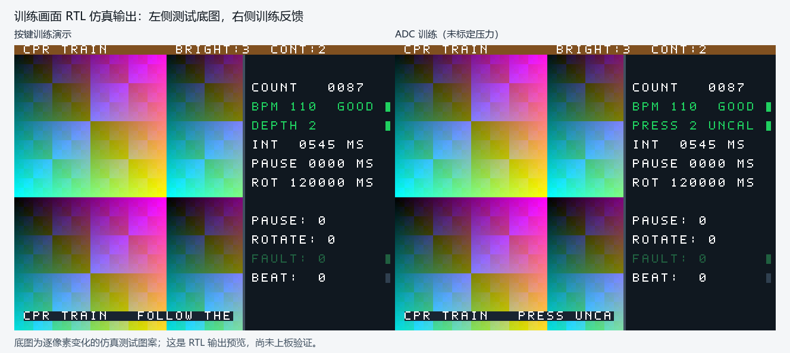

> **2026-10-25 波形／音量条与轮播转场**：已整合 main `7235989` 的 WAV 与共享SD路径；18项功能检查、3项预期故障注入通过。TD两顶层生成位流，setup +0.120/+0.159 ns、hold +0.003/+0.004 ns。原PLL／SDRAM关键告警保留，严格检查仍 failed、板级 I/O 为 conditional，新位流未上板。见[功能、预览与当前验证](project/docs/audio-and-transitions.md)。
>
> **2026-10-24 SD/HDMI 离线时序预算**：同步最新主分支，SD 传输改为约 16.67 MHz，补齐布线后 min/max 抽取与自检。现有 TD 6.2.168116 两顶层生成位流、内部 setup/hold 均为正；6 项 RTL、27 项 Python 检查通过，2 项错误注入按预期失败。严格检查仍 failed，板级 I/O 结论仍为 conditional，本次未上板。见[预算与实际结果](project/docs/io-timing-budget.md)。
>
> **2026-10-23 TD验收排查**：按本机TD6.2.168116完成两个顶层布局布线，修复页面/ADC邮箱约束绑定，增加覆盖检查及10项门禁自检。setup/hold为正，PLL与SDRAM严重告警仍未解决，严格验收failed。见[本轮验收记录](project/docs/td-acceptance-20261023.md)。本轮未下载新位流。
>
> **白线修正候选 D123**：此前两轮SRAM观察（含一次断电重连后重载同一位流）报告四页教程和训练均无白线。10项相关回归及3个错误变体检查通过；详见[修正与验证边界](project/docs/white-lines-20261023.md)。下方历史构建结论不替代本次结果。

> 2026-10-18 候选修正：刷新仅在首个请求前门控，读 FIFO 低水位优先级覆盖读段结束交接，避免后台写入导致显示重复像素。45 项 RTL 自检、5 项运行器控制通过，5 项故障注入被拒绝；本机 TD 6.2.168116 两顶层综合通过，完整验收及实板横线消失尚未确认。复现、改动及验收边界见 [本轮说明](project/docs/refresh-read-priority-20261018.md)。下文较早日期的测试和构建记录属于历史版本，不能代替当前候选的验收。

> 2026-10-17 本地修复：频率支持目标区间以外的有效数值，SDRAM 读写补刷新及首命令临界拍互锁。41 项自检与 5 项运行器检查通过；本次位流仍需用团队 SP1 完整构建并重新上板复验。改动与验证边界见 [修复说明](project/docs/display-fixes-20261017.md)。下方“当前状态”属于本次修复前的主分支基线，不能替代本次验收。

> **修复前基线状态（2026-10-17）**：40 项 RTL 自检与 5 项运行器控制全部通过；TD 6.2.178840 完整构建两个顶层均通过、零违例端点（`top` SWNS **+0.115 ns**、`top_adc` **+0.132 ns**），位流已生成，已完成首次烧写观察，完整硬件验收仍在进行。
>
> 下方按日期排列的小节是各次接入时的历史记录，其中的自检数量（23/30 项）与 TD 结论反映当时版本，**不代表当前状态**。当前数量与结论以本节和 [`project/README.md`](project/README.md) 为准。

## 中文提示与教程更新（2026-10-16）

已加入中文页眉、训练反馈与滚动字幕，以及四张自绘成人 CPR 教程。两个顶层默认中文，完整操作、字体许可、素材布局和合并说明见 [中文界面与教程](project/docs/chinese-ui.md)。缩放缓存与中文界面已在同一个 `main` 上合入并共同验证。

---

## 训练页面管理更新（2026-10-15）

在 SD 超时恢复版本上加入训练进入自动选页、前后浏览、退出恢复，以及页眉加载/缺页/错误状态。工程入口仍为 `project/project.al`，当前使用说明见[训练页面管理](project/docs/training-pages.md)。30 项 RTL 自检和 5 项运行器检查通过；本次 TD 结果另见新验证记录，下方旧构建结果不能替代本次验证。本次通过分支 `codex/cpr-sd-pages-20261015` 提交 PR。

---

# 心肺复苏实时反馈训练终端

> 第九届（2026）全国大学生嵌入式芯片与系统设计竞赛 · FPGA 创新设计赛道 · **安路赛道**
> 赛题：**选题一 — 基于安路 EG4S20 的 HDMI 多媒体播放系统**（本作品在其基础上改造为 CPR 训练终端）
> 平台 HX4S20C（安路 EG4S20BG256，19600 LUT / 8MB 片内 SDRAM）· 团队 3 人，均为"一生一芯"（YSYX）学员

## 当前代码入口（2026-10-13）

基础架构现在登记在 [`project/project.al`](project/project.al)：默认 `top` 用板载按键演示，`top_adc` 接入片内 ADC CH1 的采样、跨域、四点均值和完整释放后的按压事件。源文件、构建方法与操作见 [`project/README.md`](project/README.md)，变更来源见 [`source-provenance.md`](project/docs/source-provenance.md)。

当前实现包含三模式、训练计数/评级/计时、亮度和对比度、中文页眉与滚动字幕、四槽全缓存与加载时最近邻等比缩放，以及卡上 WAV 的 HDMI 播放和训练节拍门控。新增实际输出 PCM 的波形／音量条与自动轮播淡出淡入，说明和验证见[音频与转场](project/docs/audio-and-transitions.md)。训练画面采用左侧384像素教程与右侧256像素反馈面板，字幕在训练模式下限制在左侧；操作、坐标和素材命令见[训练布局说明](project/docs/training-layout.md)。前景仍为最近邻采样，补边背景已实现区域均值、盒式模糊、双线性放大和压暗。**压力与机械深度仍未标定，FAT32 目录／碎片文件和 FFT 频谱仍未实现，新音频／转场位流尚未上板。**下方作品简介说明设计定位，不能视为所有功能已经完成。



> 上图是 2026-10-14 的 RTL 输出，仍为**英文界面**。PR #4 之后页眉、训练反馈与字幕已全部改为中文，当前布局请参考 `cpr_text_zh.v` 或实际上板画面。

本节记录 2026-10-13 的显示接入版本，基于 `b44ce6ef90a0897d0aa43b331e4588ad3a7a0859`，发布分支 `codex/cpr-display-20261013`。**当时为 23 项产品 RTL 自检及 5 项运行器检查通过；当次 TD 6.2.168116 完整验证因 PLL/SDRAM 严重告警未通过，该告警已在 TD 6.2.178840 下消除，当前完整构建两个顶层均通过。** 验证汇总见[display-validation-20261013.json](project/docs/display-validation-20261013.json)。

**心脏骤停多发生在家中（79.2%），急救车响应中位数 12 分钟才到，黄金时间只有 4 分钟。**
**这段没人能替的时间里只有胸外按压，而会做的旁人只有 20.3%。**

本作品把 AHA 指南里"靠纸质教材根本教不会"的两条实时要求（**按压频率**、**尽量减少中断与每 2 分钟轮换**），
做成一台能按、能评、能提示的训练终端。**全部逻辑在一颗 EG4S20 内运行，无处理器。**

> 立论数据源：Lancet Public Health 2023 全国前瞻性队列（BASIC-OHCA），
> 详见 `03_技术方案/心肺复苏训练终端_完整方案.md` §4.1。

| 节点 | 日期 | 状态 |
|---|---|---|
| 报名截止 | 2026-09-22 | ✅ 已提交 |
| 板卡申请 | — | ✅ 已提交 |
| **作品提交** | **2026-11-04 18:00** | |
| 决赛 | 2026-11-20 ~ 22（南京江北新区） | |

---

## 目录结构

| 目录 | 是什么 |
|---|---|
| **`project/`** | ⭐ 安路 TD 主工程：`project.al`、`rtl/`、`ip/`、`vendor/`、`constraints/`；综合报告落 `project/build/` |
| **`tests/`** | ⭐ **验证工程**：`tests/sim/run.py` 编译产品 RTL 自检；`run.sh` 为脚本包装；`tests/board/` 为独立上板验证 |
| `05_lab_ex/` | 安路官方参考工程 `lab_ex5_i2s` / `lab_ex4_tf`；**主工程仍直接依赖其中源码和 IP** |
| `06_例程精读/` | ⭐ 参考工程逐站走读笔记（8 站） |
| `03_技术方案/` | 完整方案、硬件实证、接口规范、物料清单 |
| `04_环境与工具/` | TD 工具链安装与自检 |
| `01_竞赛信息/` | 赛题原文、竞赛全流程 |
| `_ref/` | U 盘提取的赛题资料与手册摘录 |
| `.tools/` | TD 6.2.1 SP1 工具链本体（2.7G，**不进 git**） |
| `99_归档/` | 选题阶段草稿与已废弃方向材料（**没删，只是挪走**） |

📖 **每份文档具体讲什么、什么时候看 → [`文档索引.md`](文档索引.md)**
🤝 **接手项目的 AI 助手 / 新成员 → [`交接说明.md`](交接说明.md)**（当前状态、下一步、踩过的坑）

---

## 队友如何克隆

仓库含个人材料，**不必全量克隆**，用稀疏检出只取自己负责的部分即可。
（也可以全部克隆下来 —— 你们有关的资料和信息也可以放到对应文件夹里一起管理，里面有不少东西可以参考。）

下面以稀疏检出为例：

```bash
git clone --no-checkout ssh://git@github.com/wustarlance/cpr-fpga-2026.git
cd cpr-fpga-2026
git sparse-checkout init --cone
git sparse-checkout set project tests 05_lab_ex 03_技术方案
git checkout main

git config user.name  "你的名字"      # ← 各自必设，否则提交全记成 wuqi
git config user.email "你的邮箱"
```

| 稀疏集 | 拿到什么 |
|---|---|
| `project tests 05_lab_ex` | 主工程、验证和实际编译依赖；这是当前最小代码集合 |
| `+ 03_技术方案` | 加方案、接线和素材规范 ← **推荐** |
| `+ 06_例程精读` | 加参考工程走读笔记 |

已有只检出 `project tests` 的工作树需先执行 `git sparse-checkout add 05_lab_ex`；省略参考工程会导致主工程缺源文件。

管理：`git sparse-checkout list` / `add <目录>` / `disable`（取消，全部检出）。

三条要知道的：

1. **别用 `git clone --sparse`** —— 在 git 2.34 上它是 no-cone 模式，连 `README.md` 都不检出
2. **改没检出的文件前，先 `git sparse-checkout add <目录>`**，否则文件不在磁盘上
3. 提交不必担心范围：**改哪个目录，提交的差异就只有那个目录**，未检出的文件不受影响（已实测）

---

## 团队协作

**文件所有权**（改共享文件前先在群里说一声；A/B/C 换成各自名字）：

| 文件 | Owner | 备注 |
|---|---|---|
| `project/project.al`、`timing.sdc`、`pin.adc`、顶层 `top_tf_hdmi_audio.v` | **A 独占** | ⚠️ 共享文件，改错三人一起挂 |
| 其余 `SD/*.v` | B | |
| `adc_ctrl.v`、`peak_detect.v` | C | |

当前主工程路径为 `project/rtl/top_tf_hdmi_audio.v`、`project/constraints/pin.adc`、`project/constraints/timing.sdc`；ADC/按压模块位于 `project/rtl/`。`05_lab_ex/` 保留参考内容，新修改放入 `project/`。

> 那 4 个共享文件正对应 CERN [Hog](https://hog.readthedocs.io/) 所说的「可复现性三要素」：**源文件 / 约束文件 / IDE 设置**。少一样，工程就无法在别人机器上重建。

**日常节奏**：开工 `git pull`，收工 `git push`，**每天至少进 main 一次**（分支放得越久，冲突越难解）。

**改自己的模块 → 直接推 main；改共享文件 → 必须走 PR**（PR 的 diff 是另外两人唯一能确切看见"你到底动了什么"的地方）：

```bash
git checkout main && git pull --rebase
git checkout -b feat/adc-threshold          # 从最新 main 切
# …写代码，小步提交…
git fetch origin && git rebase origin/main  # 冲突在本地解，别等到网页上
git push -u origin feat/adc-threshold       # rebase 过就要用 --force-with-lease
# → 网页发 PR → 队友 review → Merge
```

**Review 只看四件事**：① **位宽**（每次赋值/运算）② **时钟域**（有无未同步的跨域信号）③ **约束文件有没有被动过** ④ **diff 里有没有混进不该改的文件**。

> ⚠️ **PR 通过 ≠ 代码正确。** 你们没有 CI（TD 工具链 2.7G + 许可证跑不了 GitHub Actions），PR 上的"检查"只是人眼看 RTL —— 而位宽截断、跨时钟域这两类最高频的 bug，在 diff 里和正确代码长得**一模一样**。

---

## 快速开始

从仓库根目录跑仿真：

```sh
python tests/sim/run.py --all --self-test-runner
```

Windows PowerShell 综合默认顶层：

```powershell
Set-Location project
$env:CPR_TOP = 'top'
& 'E:/bin/td_commands_prompt.exe' build.tcl
```

此路径对应本次验证环境的 TD **6.2.168116**；安装位置不同需替换。ADC 顶层将 `CPR_TOP` 改为 `top_adc`；Linux 在 `project/` 中运行 `CPR_TOP=top td build.tcl`。默认执行完整构建；只综合需设置 `$env:CPR_STAGE='synth'`。本机完整验证仍有严重告警，完整工具要求、报告路径与预期按键操作见 [`project/README.md`](project/README.md)。

### 旧 Linux 环境快速开始（历史记录）

下面保留原仓库环境的操作，不代表当前 Windows 已完成下载器安装或板卡验证。

| 做什么 | 命令 |
|---|---|
| 启动 TD GUI | `td -gui`（**在你自己的终端里开**） |
| 环境自检 | `cd .tools/selftest && ../../.tools/td selftest.tcl` |
| 跑仿真 | `cd tests && ./sim/run.sh` |
| 下载位流 | `openFPGALoader -c anlogicCable xxx.bit` |

⚠️ 始终用 `td` 启动器，**别直接跑 `bin/td`**（缺 `LD_LIBRARY_PATH` 会报缺库）。
许可证、安装位置、下载器权限等明细见 [`文档索引.md`](文档索引.md)。

---

## 进度

### 当前基础架构

- 主工程源码/IP/约束清单与 `top/top_adc` 构建入口已落到 `project/`。
- ADC 控制、完整字跨域传输、压力码归一化与峰值事件已有独立 RTL 和自检 TB；训练逻辑同时支持按键/接触演示与 ADC 事件。
- 修复每行第 640 像素的 AXIS `last` 与 SD 新加载误用旧完成状态，统一所有 PLL 锁定条件并按时钟域释放复位。
- 当前数字回归与完整TD执行结果见[训练布局说明](project/docs/training-layout.md)；时钟严重告警、模拟采样与机械标定、板卡联调以及完整赛题功能仍待完成。

### 历史进度（原仓库记录）

以下是旧 Linux 参考工程的完成情况和当时待办。板卡已到手；“等板子”不是当前所有工作的前置条件，旧时序分析也不能直接作为新工程的签核结论。

**已完成** —— TD 6.2.1 SP1 部署与端到端自检 · 参考工程在 6.2.1 下编译通过（0 错误）· 全流程出位流 ·
时序约束验证（`checking no clock` 归零）· 方案定稿 · 报名与板卡申请已提交

> 参考工程 `ext_mem_clk` 的 −6.301 ns 时序违例**根因已定位**：不是"组合逻辑太长"，
> 而是 `sys_pll clkc[2]` ↔ `ext_mem_clk` 这对时钟的约束预算只有 4 ns，且路径上零组合逻辑。
> 详见 `04_环境与工具/参考工程编译修复记录_TD6.2.1.md` §4.1。

**🔴 当前唯一卡点：等板卡到货** —— 到货前所有硬件节点都停。

| 级 | 目标 | 状态 |
|---|---|---|
| 0–1 | 工具链跑通 · 看懂最小工程 | ✅ |
| 2–6 | 点亮 HDMI → 显示图片 → 按键 → 音频 → 稳定扩展 | ⏸ 等板子 |

**待办**：

- 🔴 查 `sdr_as_ram` IP 手册，确认回读数据在 `ext_mem_clk` 的哪一拍被采样 —— 决定「4 ns 还是 12 ns」的分水岭
- 🛒 备硬件 —— 清单与优先级见 `03_技术方案/物料采购清单.md`
- 确认比赛通知的"6.2.1"是否接受 SP1（178840）；确认板卡是「免费借用」还是「折扣购买」
- 确认报名表的三个下拉框（参赛厂商 / 平台 / 开发方向）填的是哪个方向
- 第三位队员：图片预处理脚本 + TF 卡同步脚本 + 测试素材
