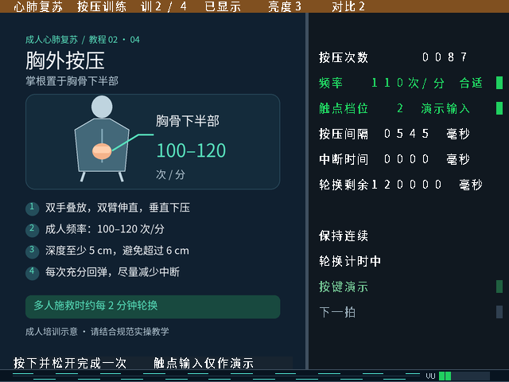
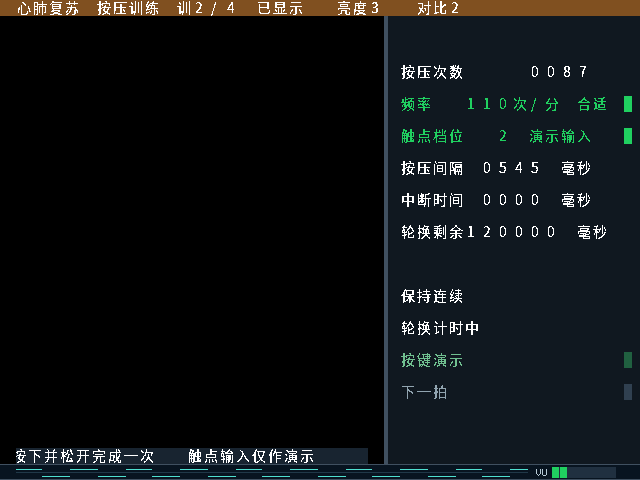

# 音频波形、音量条与轮播淡入淡出

已整合 GitHub main `7235989` 的 WAV 音源、SD 共享仲裁、FIFO 位宽与按键修正，适用 HX4S20C V1.0 / EG4S20BG256。可视化和转场不改变既有 BMP/WAV 扇区布局；要有声音仍需按队员的音频方案准备卡上的 WAV。本次没有改写 TF 卡。

## 当前验证结果（2026-10-25）

基于 main `7235989`，设计提交 `fccbe23`。18项功能检查通过，其中17项本轮执行，1项画面集成结果经全部源码和输入哈希比对后复用；3个编译成功的故障变体触发预期断言，17项 TD 检查器单元测试通过。此处是当前 WAV 整合版结果，下面10月24日的数字属于历史。

| 布局布线结果 | top | top_adc |
|---|---:|---:|
| Setup WNS | +0.120 ns | +0.159 ns |
| Hold WNS | +0.003 ns | +0.004 ns |
| Setup / Hold TNS | 0 / 0 | 0 / 0 |
| LUT / 19600 | 14466 | 14558 |
| BRAM / 64 | 46 | 46 |
| DSP / 29 | 12 | 12 |
| 位流生成 | 是 | 是 |
| 原 PLL / SDRAM 关键告警 | 7条 | 7条 |
| 严格检查 | failed | failed |

使用本机 TD 6.2.168116，构建期间设计输入和工具哈希不变。没有新增缺失时钟、失效约束、无路径或被覆盖的例外；PCM 两端均48位，PCM FIFO Gray 边界各22条、PCM数据96条、采样率38条全部生效，原帧 FIFO Gray 两组各36条及页面／ADC邮箱边界保留。总帧数诊断在本配置中已裁剪，不预绑定空路径。

原关键告警、物理悬空节点审查及板级接口要求仍未闭环，正时序余量不等于完整验收。对本轮路由检查点重新提取 SD/HDMI min/max，采集前后检查点哈希保持不变，板级结论仍为 `conditional`、`physical_signoff=false`。朗科16GB卡的具体型号／电气时序及实际板级测量仍需确认。

本轮没有下载位流、没有写 Flash 或 TF 卡。新版本仍需上板确认四页与白线、真实 WAV 声音和波形／VU一致性、训练门控、轮播转场、暂停／切模式、复位、冷启动及长时间运行。来源、位流、测试与报告哈希见[当前验证摘要](audio-and-transitions-verification-20261025.json)。

## 屏幕与音频

字幕仍在 y=448～463；新增条带只占最后 **16 行（y=464～479）**，不覆盖教程正文、训练统计和字幕。左侧为青色波形，右侧为 VU 音量条。教学、自动展播、训练三种模式均显示。

下图来自实际 RTL 仿真的逐像素输出，音频使用合成 PCM 激励，不是上板或 WAV 播放截图。训练图检查面板与底图，黑场图检查图片淡出后文字仍清晰：





监测信号与 HDMI 发射端共用 `hdmi_audio_left/right`：在训练节拍门控之后取样，静音数据也是零，不能用未门控的后台音符画出假波形。输入为视频时钟域内、有效拍限定的 24 bit 有符号 PCM。当前音源已经改为卡上的 WAV；波形和 VU 显示实际文件经过播放、静音及训练门控后的数据。没有有效 WAV 或输出静音时显示静音；这项功能没有加入 FFT。10 月 24 日旧验证使用过的内部音阶发生器已随队员分支移除。

- 波形显示左声道，每 4 个有效 PCM 样本取一个点，一次快照 256 点。按实际约 48.027 kHz 采样率，一屏约 21.3 ms，每点显示两列。
- 显示增益固定为每 `2^19` PCM 单位一像素，钳位到上下各 5 像素。波形与音量条的缩放不同；VU 仍以数字满幅为基准。
- VU 取左右声道绝对值最大值，归一为 0～63；负满幅 `0x800000` 饱和到 63。帧边界更新峰值，下降时每帧最多减 4；它不是声压或 dB 标定值。
- 使用两个 256×4 bit 快照区。捕获完成后等待 VS 再发布，显示期间只写另一个区。等待期间允许丢弃仅供波形显示的样本，音频流不回压、不丢包。
- 没有 PCM 有效拍时清除过期波形，音量条逐帧回落；关闭功能时不叠加条带。

## 轮播平滑切换

只给缓存调度器真正发起的**自动换到另一页**加转场标记。首图、普通手动翻页、训练页面请求以及单图重复显示不加标记。缓存无效的下一页不开始转场。

每次自动转场按以下顺序执行：

1. SD 域保留原来的页面索引和发布等待状态，发送持续的淡出请求。
2. 视频域在 VS 下降沿逐帧将图片增益从 16 减至 0，共 16 帧。
3. 完全黑场后才允许原 `frame_buffer_publish` 发布；仍由原读取器的帧边界切换槽号。
4. 收到原发布完成确认后释放淡出请求，再逐帧从 0 加至 16。

60 Hz 下渐变本身约 0.53 秒，另有原发布协议的帧边界等待。淡出只作用于底图，页眉、字幕、训练统计和音频条带在后面叠加，始终保持清晰。没有交叉读取两幅图片，也没有增加 SDRAM 并发读带宽。

暂停轮播后，已经开始的转场会完成，再停在新页。转场中切模式时，原队列保留新的训练／浏览目标，当前发布完成后继续处理；普通手动与训练换页本身不主动触发渐变。没有修改原来的按键功能。

SD 域等待黑场的看门狗为 100,000,000 拍（100 MHz 下约 1 秒）。若视频没有给出黑场确认，退回原发布路径并撤销淡出请求，避免新增的等待条件永久锁住队列；后续发布仍需原读取器的帧边界。

## 像素延迟与时钟

```text
SDRAM 图片 → 亮度/对比度 → 图片淡入淡出（2拍）
          → 原中文/训练 OSD → 音频条带（2拍）→ 原 RGB-to-AXIS
```

RGB、VS、DE 一起通过新增流水级，不单独延迟颜色。默认两项开启时新增 4 个 25 MHz 像素拍（160 ns），不增加一帧缓存。WAV 音频通路交付的 PCM 已在视频域，音频可视化不新增 CDC；转场请求和黑场确认是双向持续电平，各由目的域两级寄存器接收，原页面索引仍走原发布协议。相关 PLL 时钟继续接受时序分析，可视化/转场没有增加时序豁免。WAV 整合使用逐同步器首级的例外及显式数据飞行时间边界，不采用整组时钟互切。

`top` / `top_adc` 均提供以下编译参数，默认开启：

```verilog
.ENABLE_AUDIO_VISUALIZATION(1)
.ENABLE_SMOOTH_TRANSITIONS(1)
```

`ENABLE_AUDIO=0` 或 `ENABLE_AUDIO_VISUALIZATION=0` 时音频条带编译为旁路；`ENABLE_SMOOTH_TRANSITIONS=0` 时图片及发布握手恢复直接通路。两个功能可分别关闭。

## 自检与实板边界

- `tb_audio_visualizer`：4 个完整 640×480 画面、双缓存冻结、正负满幅、零值、无效拍噪声、VU 保持/回落、停流、关闭、复位，以及 AXIS 每行第 640 像素的 EOL。
- `tb_slide_transition`：实际帧发布模块、16 档 RGB 算术、黑场前禁止发布、延迟 ACK 期间保持黑场、淡入、手动旁路、无 VS 超时及中途复位。
- `tb_presentation_pipeline`：真实教程 BMP 与原中文 OSD，检查默认、训练和黑场三帧的内容与边带对齐；新条带区域单独由前一用例逐像素核对。
- 扩展 `tb_sd_scaled_pages`：只有自动换到另一页带转场标记，手动/训练/首图/单图不带标记；保留原四槽、异常恢复和页面所有权检查。
- 两个错误变体分别把波形变平、让自动发布绕过黑场等待；检查它们确实编译成功并因具体像素或握手断言失败。

本次功能仿真、工具构建和新位流实板观察是不同证据。此前 D123 的无白线记录不能代替本次新增逻辑的上板结果；完整结果及哈希保存于同目录的本次验证摘要。TD 原有 PLL/SDRAM 关键告警仍按现有严格门禁记录，不通过新增功能自动豁免。

## 历史结果（2026-10-24，已被 WAV 整合版取代）

以下数字只对应更新前的源版本，不能作为当前版的时序结论。该版本还存在后来修正的生成块复位网声明顺序问题，新版已将复位网提前声明并在检查器中拒绝此类悬空网。

设计提交 `1876660785c7b68b625f0cab43ee849e82597e2c`，TD 6.2.168116，构建 `verify_20261024T151904.544047Z`。构建期间设计输入和工具哈希均保持不变。**12 项功能自检通过，2 个错误变体编译成功并被预期断言拒绝。**

| 最终布局布线 | top | top_adc |
|---|---:|---:|
| Setup WNS | +0.109 ns | +0.117 ns |
| Hold WNS | +0.011 ns | +0.011 ns |
| Setup / Hold TNS | 0 / 0 | 0 / 0 |
| LUT / 19600 | 12756 | 12806 |
| BRAM / 64 | 40 | 40 |
| DSP / 29 | 12 | 12 |
| 新位流生成 | 是 | 是 |
| 关键告警条数 | 7 | 7 |
| 严格检查 | failed | failed |

两个顶层均没有新增缺失时钟、未绑定路径或失效约束项；原 PLL/SDRAM 三类关键告警保留，接口清单仍为 `needs_review`。该结论表示内部时序为正，不表示零告警或板级签核完成。

对这次实际路由检查点重新提取 SD/HDMI min/max 路径，均完整且采集前后检查点哈希不变；保留 0.100 ns 不确定性及参考卡 tCO=14 ns 后，16.667 MHz SPI 的 PCB 往返条件预算分别为 **6.539 / 6.949 ns**。朗科 16 GB 具体卡端参数及物理波形仍未确认，`physical_signoff=false`。

机器可读结果、位流及来源哈希见[本次验证摘要](audio-and-transitions-verification-20261024.json)。未下载这些新位流、未写 Flash 或 SD；下一步上板检查四页与白线、波形/VU、训练节拍与静音、自动转场、暂停与切模式、冷启动及长时间运行。

复现新增检查（在仓库根目录，输出目录必须是新的）：

```text
python tests/sim/run.py tb_audio_visualizer tb_slide_transition tb_presentation_pipeline tb_sd_scaled_pages --timeout 420 --output <新的仿真目录>
python project/verify_td.py --td <TD>/bin/td_commands_prompt.exe --tops top top_adc --stage full --timeout 1200
```

集成用例包含两个原中文 OSD 实例和三个完整画面，首轮 90 秒墙钟上限不足，日志保留为 timeout；增大到 420 秒后完整执行通过，没有删除或放宽断言。RTL 中的仿真超时仍为有限边界。

错误变体的具体修改是：将 `wave_height=5-q;` 替换为 `wave_height=4'd5;`，应报像素错误；将发布桥的 `ready_sync || guard_count>=GUARD_CYCLES-1` 替换为 `1'b1`，应报黑场前提前发布。变体只生成在本地临时证据目录，交付源文件不含这些改动。

## WAV 整合与 CDC（2026-10-25）

保留主分支 WAV 读取和 SD 仲裁接口，图像缓存调度器只增加自动转场标记。顶层的 ACR 使用工程内 `rtl/audio/audio_arc_calculate.v`，移除退役音源和重复 ACR 的旧源注册，并将工程根路径改为相对路径，便于检出使用。

原合入的 `project_cdc.sdc` 把 SD、SDRAM、视频和音频分为互切时钟组，会跳过已有边界；现改为端点级约束：原帧 FIFO Gray 两组各36条、页面邮箱、ADC 邮箱继续检查。PCM FIFO 写指针（100 MHz）最大飞行9.7 ns，读指针（12.295 MHz）80.9 ns，仅在第一同步级排除普通 hold 相位检查；后一级继续检查。

WAV 约束统一在 `optimize_gate` 和物理单元合法化后加载。ADC 顶层中常量输入的同步器可在映射期间被裁剪，先加载例外再跳过第二次加载仍会留下失效的旧约束；延后绑定可以按实际留下的端点决定是否应用。

这版 TD 的 `read_sdc` 实测仍会记录条件块内指向缺失循环同步器的例外。循环首级例外现单独放在 `wav_loop.sdc`，由 `build.tcl` 在普通 Tcl 条件中决定是否读取，避免依赖 SDC 内的条件判断。只读复核已检查失效项清零且四组 WAV 数据边界仍生效；它不能代替最终完整构建。

PCM 48位源数据保持一个完整音频采样周期，toggle 经过同步后才捕获，限制数据飞行40 ns。采样率/总帧数与配置toggle同时快照，使目的域只读取本次已提交的配置，配置飞行限制80 ns。未输出总帧数诊断时源快照会被优化掉：`build.tcl` 只在门级映射后源和目标都存在时才绑定这条可选路径，避免预先绑定的约束在寄存器被裁剪后失效。播放、静音电平先在 MCLK 经过两级同步，再使用。

新增 `tb_wav_visualizer` 使用实际 WAV 读取器、PCM FIFO/播放器和波形模块，检查16 bit立体声到24 bit的符号/位序、停止重读、静音和训练门控、VU恢复。另在文件头提交后故意改变解析器侧配置，检查目的域仍取得正确快照；这是测试注入，当前解析器重读时通常保留这两个字段，不能将其描述为已复现的自然故障。取消快照的错误变体会在目的域捕获断言处失败。波形仍显示左声道，VU取两声道绝对值较大者。

配置错误变体只在临时目录生成：将 `S_sr <= S_cfg_rate_hold` / `S_ftotal <= S_cfg_total_hold` 两个目的域赋值改回直接读取 `W_wav_sr` / `W_wav_ftotal`，用同一测试注入检查。交付 RTL 保留快照。新增检查可在仓库根目录复现，输出目录应使用新目录：

```text
python tests/sim/run.py tb_wav_visualizer tb_audio_visualizer tb_slide_transition tb_sd_scaled_pages --timeout 150 --output <新的音频仿真目录>
python tests/sim/run.py tb_presentation_pipeline --timeout 420 --output <新的画面集成目录>
python -m unittest discover -s tests -p "test_td*.py" -v
python project/verify_td.py --td <TD>/bin/td_commands_prompt.exe --tops top top_adc --stage full --timeout 1800
```

本轮构建及复验已完成，结果见文首表格和2026-10-25验证摘要。此前交接包保留为历史，不能覆盖 WAV 新主分支。
