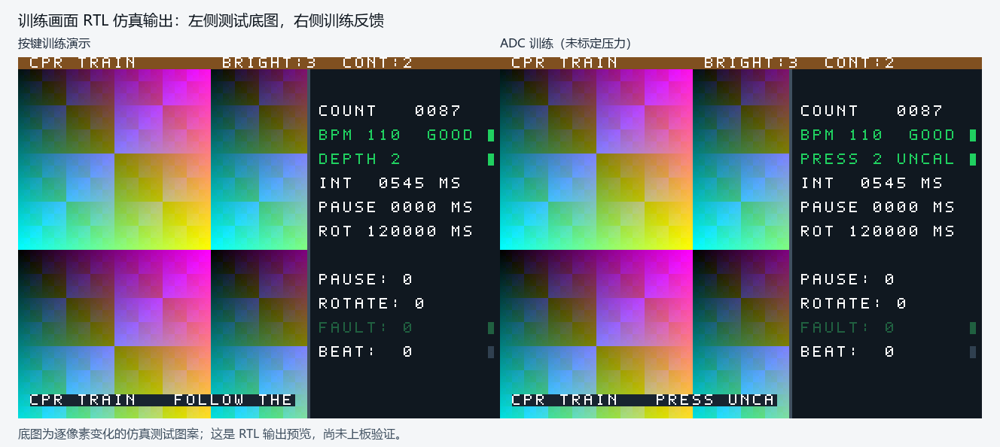

> 2026-10-15 更新：本文件描述 10 月 13 日的布局改动。训练进入自动选页、前后翻页、退出恢复现已实现，见[训练页面管理](training-pages.md)；下方“未新增自动跳图接口”和旧验证数字仅适用于当时版本。

# 训练底图分区修复

2026-10-13，在已接入对比度及ASCII字幕的本地工程上修改。针对训练模式中整屏纯色背景覆盖教程图的问题，移除整屏覆盖，将实时反馈放入右侧面板。工程入口为`project/project.al`，器件仍为HX4S20C / EG4S20BG256。

## 画面与素材约定

输出仍为640×480、25MHz像素时钟；RGB组合叠加不增加像素寄存器、流水延迟或帧缓存。状态及模式继续在VS下降沿取快照，帧中变化不会让半帧切换布局。

| 区域 | 像素范围（含端点） | 行为 |
|---|---|---|
| 原模式/亮度/对比度标题 | y0～15 | 保留原标题栏 |
| 教程主体 | x0～383，y16～447 | 输入底图像素直接透出，无训练文字或色块 |
| 反馈面板 | x384～639，y16～479 | 深色背景；x384～387为分隔线 |
| 反馈文字 | x400～623 | 每行14个16像素字符单元，字模宽10像素 |
| 评级/故障/节拍标记 | x624～631 | 与文字分开 |
| 训练字幕 | x16～367，y448～463 | 字幕不会进入右侧面板 |
| 教学/自动字幕 | x16～623，y448～463 | 保留原宽度 |

反馈显示COUNT计数、BPM及SLOW/GOOD/FAST、DEPTH或PRESS UNCAL、INT按压间隔、PAUSE中断时间、ROT轮换剩余毫秒，并将暂停、轮换、故障与节拍标志拆成四行。深度档位显示0待测、1过浅、2合适、3过深，英文为WAIT/LOW/GOOD/DEEP；数字饱和、评级颜色、节拍捕获和ADC未标定提示保留。教学与自动模式不绘制训练面板。

**现有未排版的640×480图片会透出左侧384像素，右侧仍被数据面板占用；本次没有加入运行时图像缩放。** 为让整张教程内容完整显示，新增素材预处理工具，将完整原图等比例放进x16～367、y32～431，居中留边，再保存为640×480、24位无压缩、正高度BMP。这样与现有SD/BMP/SDRAM链路相容，保留标题、字幕及右侧反馈空间。

```powershell
# 使用已安装Pillow的Python；缺少时执行 python -m pip install Pillow
python project/tools/prepare_training_bmp.py "原始教程.png" "教程_训练分区.bmp"
```

工具保留输入图，拒绝覆盖已有输出；支持横图、竖图、EXIF方向及透明图的背景合成。输出再按工程现有原始扇区素材流程部署，本次没有写TF卡。图片仍由现有媒体链选择，本次未新增进入训练时自动跳到指定教程图的接口。

## 验证

- **23项产品RTL自检、5项运行器检查通过。** 完整清单运行中22项通过；新增训练自检的预览导出路径最初写错，导致该项明确失败。修正工作区的导出路径后单独重跑该项通过。两份原始记录均保留；23项采用的源码、期望表、运行器和工具哈希按当前文件重新核对，没有把失败记录改写为通过。
- 新增自检共**1,090,560次栅格比较**，包括普通与ADC训练、正常与告警数据、完整正常帧、告警行、左侧原像素/零延迟、左右边界、右侧全部文字/单位/标志、无效BPM、显示饱和、帧中模式/状态变化、回到教学/自动、字幕边界和DE空白期。
- **恢复整屏覆盖的故意变异被自检拒绝**：第16行左侧首个像素报告底图被覆盖；变异只在独立临时目录，产品源码保持原样。
- 素材工具的横图与竖图检查通过：四个象限全部保留、比例/边界正确、面板/标题/字幕区域留空、BMP格式与正高度正确、覆盖输出被拒绝。该工具验证使用Pillow 12.3.0。
- `训练画面_仿真预览.png`来自自检实际输出像素；渐变底图是仿真测试图案，不是真实CPR教程，也不是上板照片。

完整画面扫描在本机约60秒，仿真运行器默认每次编译/运行超时改为120秒；空跑、失败文本、fatal和无穷循环仍分别通过独立0.5秒控制项验证。

## TD复查与限制

本次对修改后的`top`和`top_adc`用TD 6.2.168116执行完整综合、布局布线、静态时序和位流生成。当前约束下setup/hold裕量为正：

| 顶层 | LUT | Setup WNS | Hold WNS | 严格验证 |
|---|---:|---:|---:|---|
| top | 6178 / 19600 | +0.186 ns | +0.003 ns | failed |
| top_adc | 6433 / 19600 | +0.149 ns | +0.003 ns | failed |

**完整TD门槛仍未通过**，严重告警类别为PHY-5079, PHY-7002, USR-6135：PLL反馈路径本地网络、内置SDRAM移相时钟本地布线及SDRAM宏中间重新定位。没有修改PLL、引脚、SDRAM、FIFO或时序例外来绕过这些告警；正裕量和生成位流不能替代它们的处置与实板观察。本次位流仅作诊断，不随源码包交付。

数字验证汇总见[display-validation-20261013.json](display-validation-20261013.json)，完整证据在PR附件`cpr-display-evidence-20261013.zip`；原始数字证据索引为`验证索引.json`；TD最终原始结果为`project/build/verify_20261013T062309.847646Z/results.json`。源码ZIP含工具、文档、23项清单及全部原有注册依赖；增量补丁针对上一个本地接入版，合并补丁针对GitHub基线`b44ce6ef90a0897d0aa43b331e4588ad3a7a0859`。上述验证执行时没有发布GitHub提交或PR，也没有烧板、擦Flash或写TF卡。发布阶段仅整理文档与预览，RTL、工程配置及约束与已验证输入逐字节相同。



