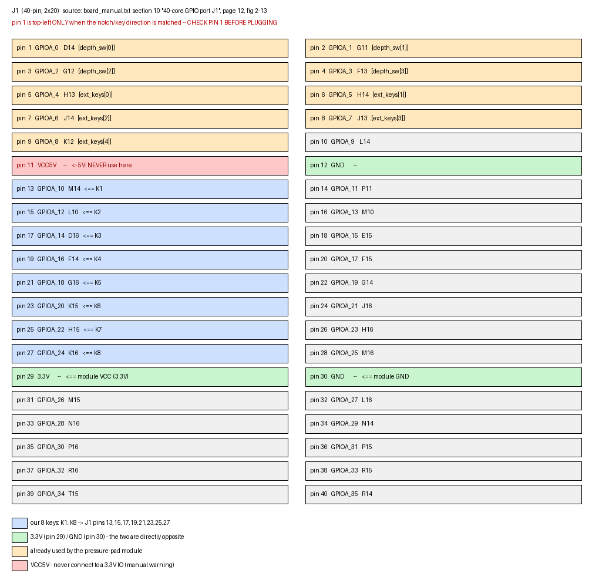

# 八位按键模块接线自检（八键测试）

与产品 `top` / `top_adc` 完全独立的测试工程：只读 8 个按键，驱动数码管和 LED。
不动产品 RTL、不动产品引脚约束，构建在自己的 `project/build/md_*/` 目录里。

## 模块资料（商品参数）

| 项 | 值 |
|---|---|
| 结构 | VCC、GND、K1~K8 共 10 脚，单排 |
| 工作电压 | 3.3–5V |
| 上拉电阻 | **有**（模块自带） |
| 输出 | **按下 = 低电平，松开 = 高电平** |
| 电源指示 | 3mm 绿色 LED |


## 引脚图



官方出处：`_ref/手册摘录/board_manual.txt` 第 317~360 行，章节 **⑩、40芯GPIO扩展口J1**
（手册第 12 页），**图2-13「JP1 40芯口的引脚原理图」** 及其下方的 **「J1 扩展口引脚分配表」**。
`j1_pinout.png` 是按该表逐行还原的对照图，不是手册截图。

## 接线（J1，40 针 2×20）

**必须先认准 J1 的 pin 1**：手册写明“要根据实物的缺口方向，J1 的第一脚在正方向左上1为第一脚位号”。

| 模块引脚 | J1 脚 | 行 | 说明 |
|---|---|---|---|
| VCC | **29** | 奇数行 | **3.3V**。不得接 pin 11（VCC5V） |
| GND | **30** | 偶数行 | 与 pin 29 正对，一根短线即可 |
| K1 | 13 | 奇数行 | GPIOA_10 |
| K2 | 15 | 奇数行 | GPIOA_12 |
| K3 | 17 | 奇数行 | GPIOA_14 |
| K4 | 19 | 奇数行 | GPIOA_16 |
| K5 | 21 | 奇数行 | GPIOA_18 |
| K6 | 23 | 奇数行 | GPIOA_20 |
| K7 | 25 | 奇数行 | GPIOA_22 |
| K8 | 27 | 奇数行 | GPIOA_24 |

K1~K8 全部位于**奇数行、连续 8 个位置、共线**；3.3V 就在紧接着的 pin 29。

### 为什么 VCC 不能接 pin 11

手册原文（`_ref/手册摘录/board_manual.txt:146-148`）：

> IO口连接到FPGA引脚上，电平为3.3V。**切勿直接跟5V设备直接连接，以免烧坏FPGA**。

本模块自带对 VCC 的上拉。若 VCC 接 5V，松开按键时每个 K 脚都是 5V，直接加在
FPGA 的 3.3V 输入上。**必须用 pin 29 的 3.3V。**

### 为什么不能 10 根全在一列

J1 的 3.3V 只在奇数行（pin 29），GND 只在偶数行（pin 12/30）。同一列拿不到两个
电源，所以 GND 用一根短线从 pin 30 引。

## 构建

```sh
python3 tests/board/keys/build_keys.py --td .tools/td --stage full
```

输出 `project/build/md_*/top_key_test.bit`，并在 `results.json` 记录工具版本、
源文件哈希、时序与验收状态。脚本不会烧板。

## 显示约定

数码管左起第 1~8 位对应 K1~K8：

- 按下 Kk → 第 k 位显示数字 `k`
- 松开   → 该位不亮
- 板载 LED 显示**同时按下的个数**（二进制，0~8）

按键经两级同步 + 约 1.3 ms 周期消抖。

## 上板检查清单

1. 先断电接线，接完用万用表确认：VCC 对 GND 是 3.3V，不是 5V
2. 逐个按 K1~K8，对应位应各自亮起；松手立即熄灭
3. 两键同按，两个位同时亮，LED 显示 `0010`
4. 八键全按，八位全亮，LED 显示 `1000`
5. 若某一位始终不亮 → 该根线或该按键问题；若某一位常亮 → 该脚被拉低（短路或接错到 GND）

## 边界

- 本工程只验证接线与按键极性，不验证按键功能分配到产品模式（那是产品 `top` 的事）
- 引脚表来自 `_ref/手册摘录/board_manual.txt` 的 J1 引脚分配表，与产品 `pin.adc`
  现有占用（`depth_sw_n` = pin 1~4，`ext_keys_n` = pin 5~9）无冲突
